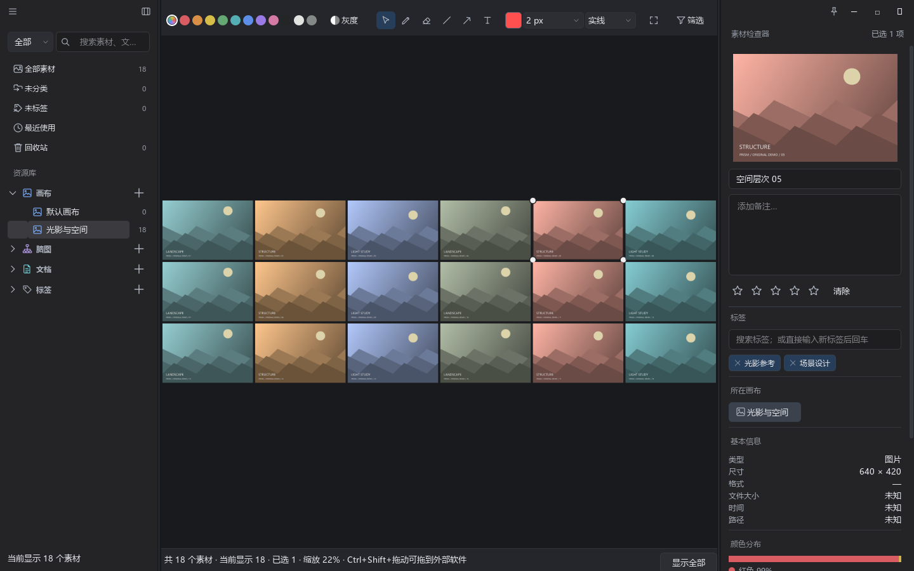
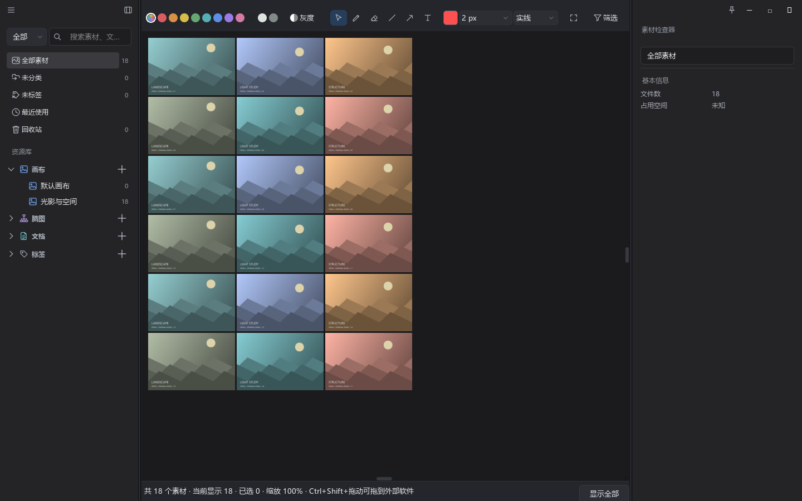
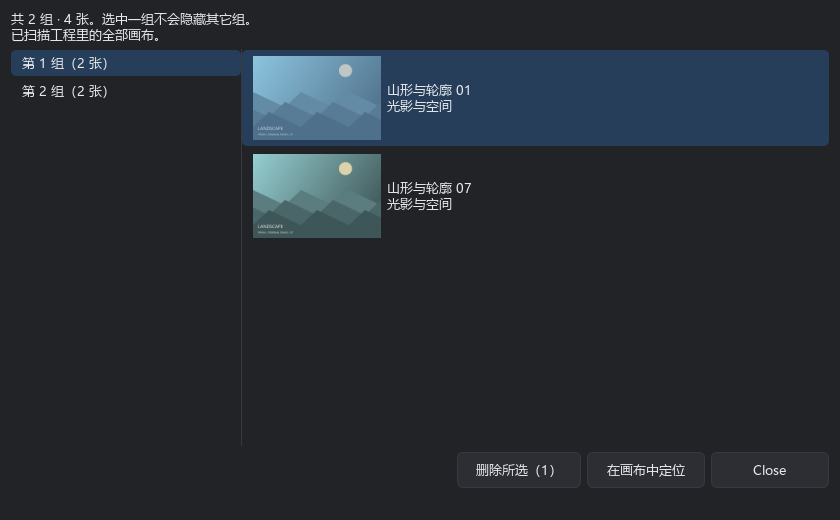
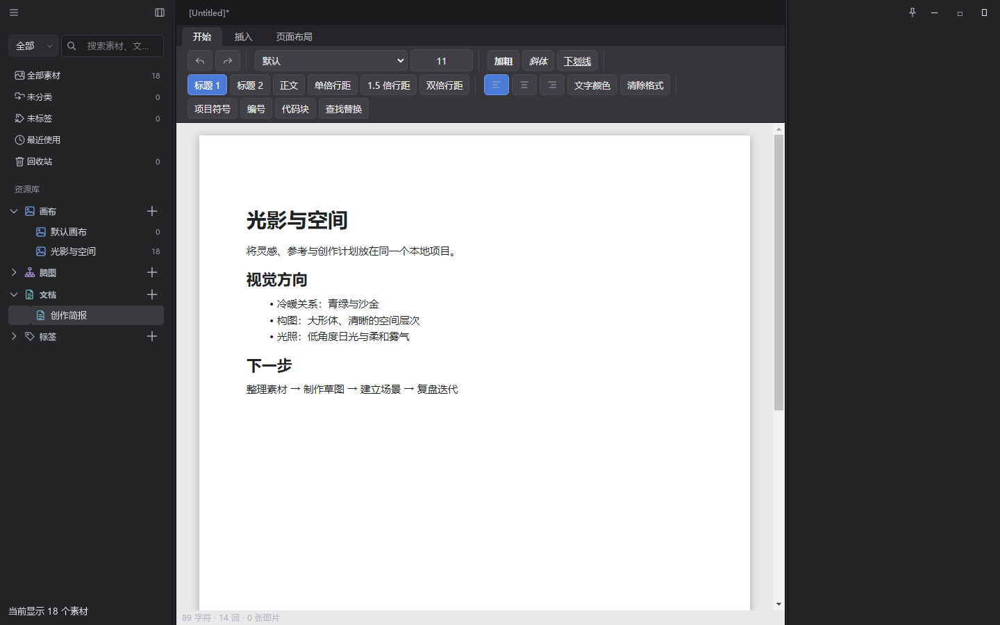
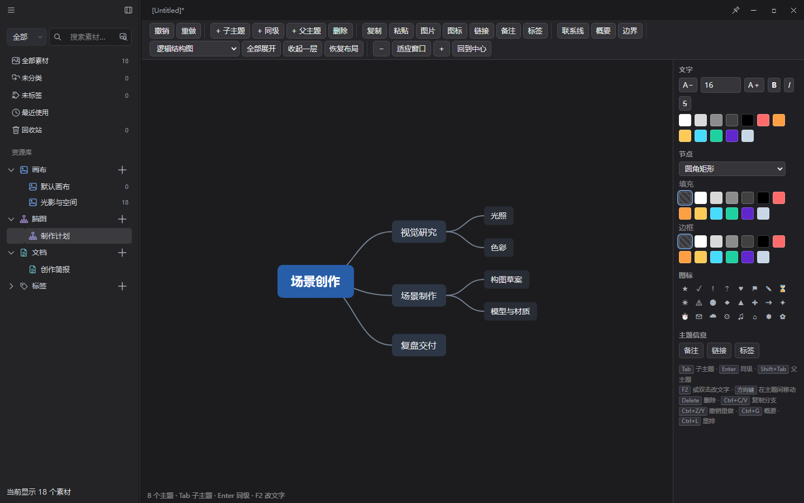

# Prism

A local workspace for reference images, drawing notes and creative planning.

[Download the Windows x64 installer](https://github.com/CLF7758/Prism/releases/download/v0.3.10/Prism-Setup-0.3.10-windows-x64.exe) · [Release and matching source](https://github.com/CLF7758/Prism/releases/tag/v0.3.10) · [中文介绍](README.md)

- Arrange reference images on an infinite canvas. Move, resize, crop, rotate and compare them.
- Annotate with a pen, arrows and text. Image arrangement leaves annotations in place.
- Capture a screen region with Ctrl+Alt+A and send it to a canvas.
- Pin reference images to the desktop and adjust their opacity.
- Organize assets with folders, canvases and tags.
- Search the project using an image, with local OpenCLIP, FAISS and OpenCV. No API key is needed; results consider content, color and layout.
- Review duplicate images and locate them on their canvases before deciding what to remove.
- Extract frames from local videos and arrange them automatically.
- Keep rich text documents and mind maps in the same project.

The installer includes Python runtimes, capture dependencies and the local search model. It is larger because these components are bundled. First image search builds a local index and takes longer than subsequent searches. Windows x64, primarily tested on Windows 11; installer is not digitally signed.

Projects are stored locally as `.prism` files. Imported image originals are retained when available; display previews do not replace source bytes. Old missing originals cannot be reconstructed from thumbnails. Keep backups of important projects.

Source development requires Python 3.12. See [Chinese setup instructions](README.md), [packaging](packaging/README.md), [third-party notices](THIRD_PARTY.md) and [license](LICENSE). GPL-3.0-or-later; original upstream copyright notices are retained.
