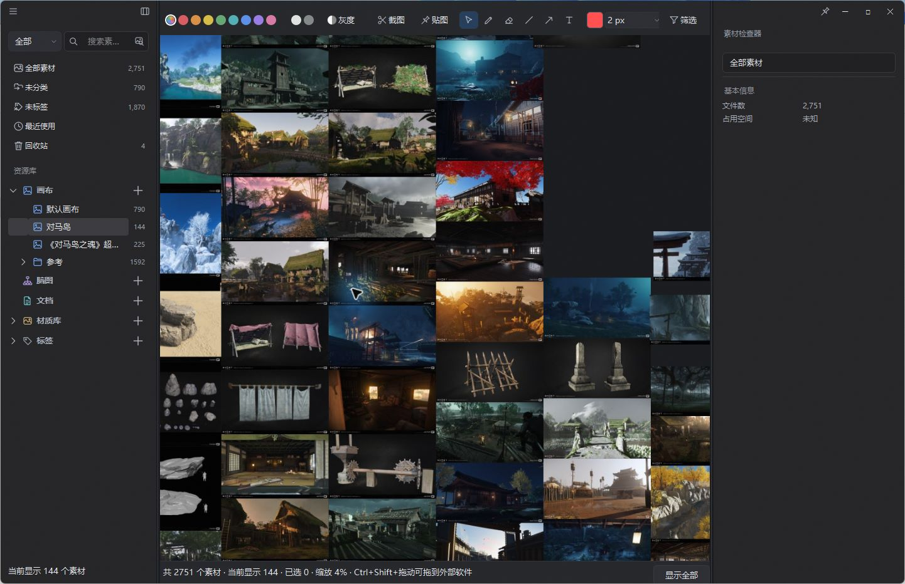
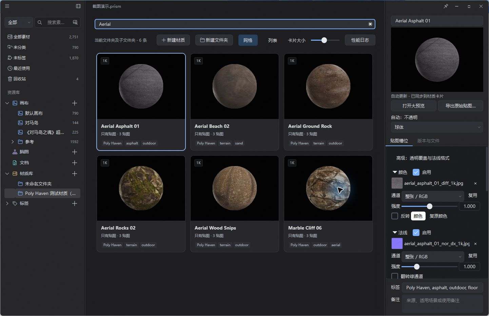
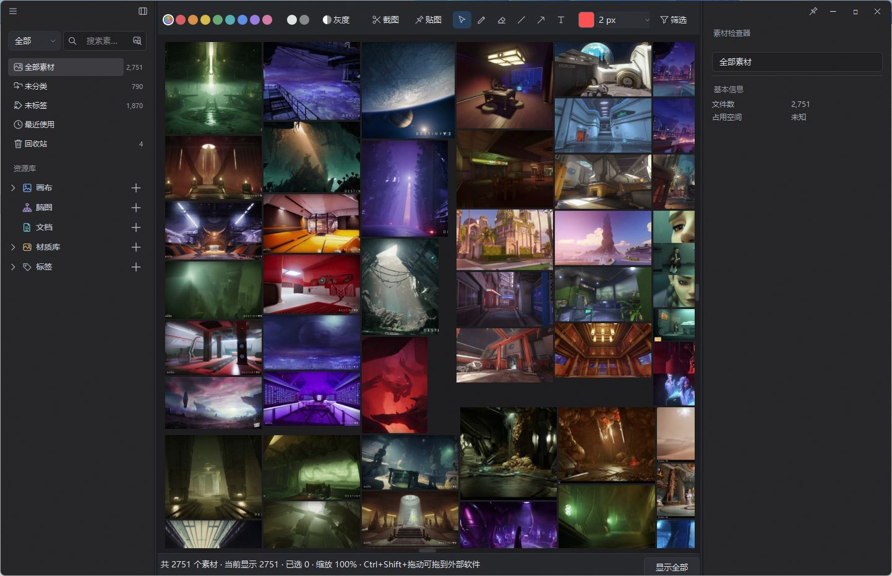

# Prism

A local creative workspace for reference boards, PBR materials, documents and mind maps.

[Windows x64 installer](https://github.com/CLF7758/Prism/releases/download/v0.4.0/Prism-Setup-0.4.0-windows-x64.exe) · [Release and matching source](https://github.com/CLF7758/Prism/releases/tag/v0.4.0) · [中文](README.md)

## Reference boards

Arrange, crop, rotate and annotate reference images on an infinite canvas. Organize multiple boards with folders and tags, search across the project, and locate results in context.

## PBR material library

Create a material, drop original textures into the right-hand slots, and select RGB or individual channels independently. Organize materials with folders, tags and notes; browse a grid or list, Ctrl-select multiple materials and export original textures.

Slots cover base color, normals, roughness, metalness, AO, opacity/masks, emission, SSS and displacement. Babylon.js renders plane, sphere, cylinder and cube previews, with an expanded viewer and individual channel inspection. SSS is a thin-surface approximation, not a reproduction of arbitrary Unreal Engine shaders. Temporary appearance adjustments reset when leaving a material; texture bindings, channel selections and metadata are retained.

The screenshots show a copy of the user's actual test project, including its real reference boards and 300 test materials. The project and source asset collection are not distributed with Prism. Reference artwork belongs to its respective authors.

## Asset organization and other tools

- Local visual search and duplicate review.
- Screen capture, desktop-pinned references and annotations.
- Local video playback, frame extraction and supported platform downloads.
- Rich text documents, mind maps, import/export and PDF output.
- GLB/glTF viewing through Babylon.js's official loader.

Source bytes are stored separately from disposable previews. Original-texture export preserves those bytes; rendered exports, crops and video frames are newly generated outputs. Missing originals in old projects cannot be reconstructed from thumbnails.

Unreal Engine integration, automatic material instance creation, and an FBX/OBJ conversion model library are not delivered features in this release.

## Installation and development

Windows x64, primarily verified on Windows 11. The unsigned installer includes the optional workflow components; compare its hash with `SHA256.txt` in the release. PBR viewing requires working WebGL/GPU support. Large-project cold loading and some initial previews can still stall; see [release notes](docs/RELEASE_0.4.0.md).

Python source runs require Python 3.12. See [Windows packaging](packaging/README.md), [extension guidelines](docs/ARCHITECTURE_EXTENSION_GUIDE.md), and the Chinese README for setup commands.

GPL-3.0-or-later. Original project copyright: Rebecca Breu. See [NOTICE](NOTICE) and [third-party notices](THIRD_PARTY.md).
