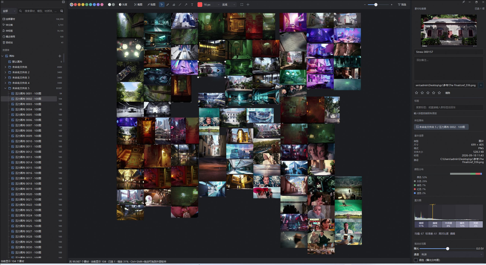
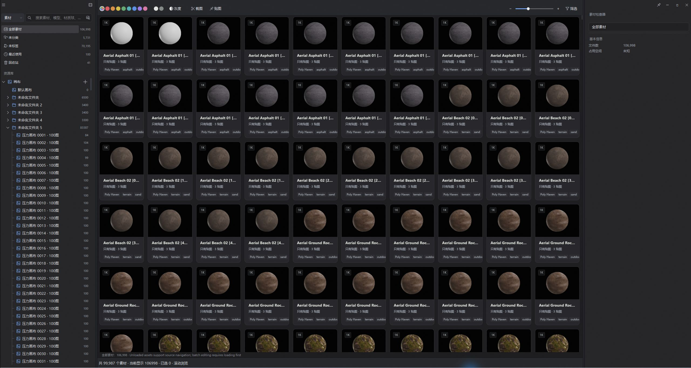
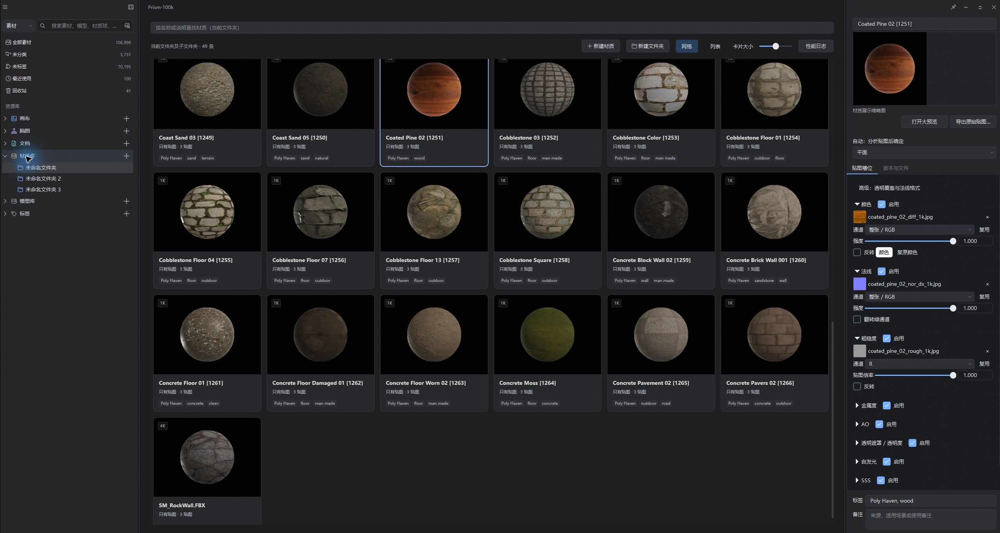
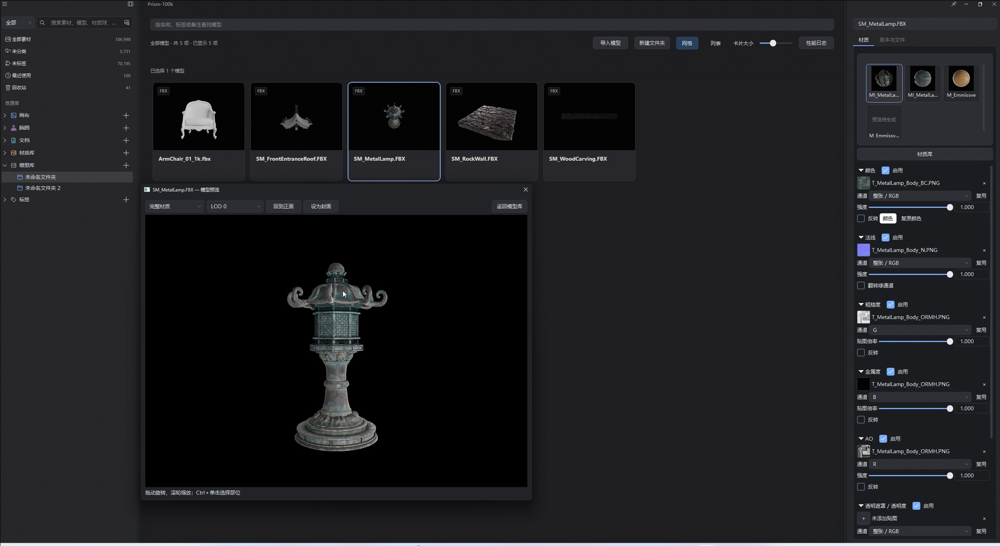

<p align="center"></p>
<h1 align="center">Prism</h1>
<p align="center">A local creative asset workspace for reference boards, PBR materials, 3D models, documents and mind maps.</p>

[Download the complete Windows installer](https://github.com/CLF7758/Prism/releases/latest) · [0.5.0 release notes](docs/RELEASE_0.5.0.md) · [中文](README.md)

Prism brings reference collection, asset organization, material/model previews and production notes into one local project. Images, canvases, mind maps, documents, materials and models are peer resources. All Assets, Unclassified, Untagged, Recent and Trash are views of the same project resources.

Screenshots below come from the user's actual Prism project. Only application screenshots are published: the project database, original assets, credentials and personal settings are not distributed. Reference artwork remains the property of its respective rights holders.

## Reference boards and image inspection



- Multiple canvases, organized into nested folders.
- Move, scale, rotate, flip, crop and arrange reference images.
- Text, brush strokes, lines and arrows for visual analysis.
- Canvas zoom, fit/center controls, screen capture and desktop reference pins.
- The complete image inspector shows preview, name, notes, tags, rating, source canvas/folder, image information, color distribution and histogram.
- Exposure/channel/false-color inspection is separate from original source bytes.

## Unified browsing, folders and search



Browse images, pages, materials and models in one resource grid. Unclassified and Untagged include non-image resources too. Recent retains up to 100 resources per project; revisiting moves an entry forward, and newer resources displace the oldest. Trash supports soft deletion and the available restore/permanent-delete workflows.

Nested folders organize canvases, documents, mind maps, materials and models. Folder clicks browse lists; opening an actual canvas enters the infinite board. Folder queries are constrained to their source canvases. Tree guides, disclosure arrows and automatic creation focus make hierarchies easier to navigate.

Ctrl and Shift selection, drag/move workflows, F2/name editing, card-size controls and Ctrl+wheel zoom support organization. A single image click shows its full inspector; its source button or a double-click opens the original canvas.

Global text search covers asset information, pages, materials and models. Type/tag/rating filters narrow results. Local visual similarity search and duplicate-image inspection provide separate tools for reference discovery and cleanup.

## Material library



Store PBR texture originals, channel bindings, names, tags and notes. Material cards and a larger preview make stored materials recognizable.

- Base color, normal, roughness, metallic, AO, opacity/mask, emissive, SSS and displacement texture slots.
- Add/drop/replace/remove textures, inspect thumbnails, select channels, enable slots and adjust numeric values.
- RGB/R/G/B/A channel choices support packed maps such as ORM; normal data uses complete RGB vectors.
- Transparency mode, cutout threshold, base-color alpha handling and DirectX/OpenGL normal conventions.
- Sphere, plane, cylinder and cube preview meshes plus channel views.
- Sliders span 0–1, with 1 at the right edge; numeric entry supports higher applicable strengths.

The material and model libraries reuse texture controls, parameter rules and the Babylon.js preview pipeline. They share one studio HDRI asset; both currently use environment intensity 1.0 and exposure 1.0.

SSS and displacement **texture management** is distinct from rendering support. Prism does not promise complete volumetric scattering, thickness simulation, subdivided geometric displacement or identical final Unreal Engine shading.

## Model library



- Import FBX, OBJ, GLB and glTF, retaining original model/dependency files.
- Organize model cards, cover images, tags and notes by folder.
- Inspect actual model material slots and replace the current slot from the material library.
- Reuse material texture-slot management for model materials.
- Open a model preview, orbit/zoom, inspect supported modes/LODs, return to front and capture a cover from the current view.
- Export a model and its associated texture originals into one destination folder.
- Drag model/texture files out for another application, including Unreal Engine's Content Browser. Automatic UE material/master-material creation is not provided; source-format compatibility depends on the destination application.

Prism is a library and reference tool, not a replacement for DCC modeling software or a full engine material editor.

## Documents, mind maps and collection tools

Rich-text notes, embedded images and mind maps live in the project alongside assets. Folder listings use page-title cards instead of opening every editor. Corresponding import/export/PDF entry points are available; complex external-format content should be checked against the actual file.

Screen capture can send a region to a canvas or a desktop pin. Local video references support posters, playback and frame extraction. Independent download components handle supported platforms, subject to network, login permissions and upstream API changes. The [browser collection extension](browser-extension/README.md) works with Prism's local receiver.

## Eagle import

Import an Eagle library through the menu, preserving readable folder relationships, names, notes, ratings and tags. Folder contents become the corresponding Prism canvas/directory organization. An already-open saved project receives the import directly; an initial conversion can create a new project. Eagle source libraries are read without being rewritten; unsupported types are skipped with feedback.

## Projects, originals and recovery

Current managed projects consist of a `.prism` entry and its `.prism.data` directory. Keep them together when moving or backing up a project. Metadata and original objects are managed separately from display caches. Original export retrieves original bytes, not reduced thumbnails.

New/open/save/save-as, recent projects, autosave and recovery entry points are available. Recovery only covers successfully persisted checkpoints; it does not replace backups or recreate originals already missing from an old project. Existing diagnostics record functional failures and performance events.

## Install

Download `Prism-Setup-0.5.0-windows-x64.exe` and `SHA256.txt` from [Releases](https://github.com/CLF7758/Prism/releases/latest). The per-user Windows x64 installer includes the application, Qt/WebEngine, image/video dependencies, capture tools, local visual-search model and download components. No separate Python installation is required.

3D previews need a working GPU/WebGL environment. Online platforms require connectivity and appropriate access. Windows 11 is the primary development environment. Builds are unsigned; verify the release SHA-256. Large projects, cold preview startup and thumbnail generation remain hardware/content dependent; test coverage is not a guarantee of flawless behavior on every computer.

## Source

Python 3.12 is required:

```powershell
python -m venv .venv
.\.venv\Scripts\python -m pip install -r requirements/windows-lock.txt
.\.venv\Scripts\python -m pip install --no-deps -e .
.\.venv\Scripts\python -m prism
```

Source installations prepare independent components using `tools/setup_*_component.py`. See [Windows packaging](packaging/README.md), [architecture/extension guide](docs/ARCHITECTURE_EXTENSION_GUIDE.md) and [issues](https://github.com/CLF7758/Prism/issues).

## License

GPL-3.0-or-later; original copyright notices for Rebecca Breu are retained. Third-party notices and source/build information are in [THIRD_PARTY.md](THIRD_PARTY.md), [NOTICE](NOTICE) and the installer license directory. This does not transfer rights to user-imported artwork or assets.
