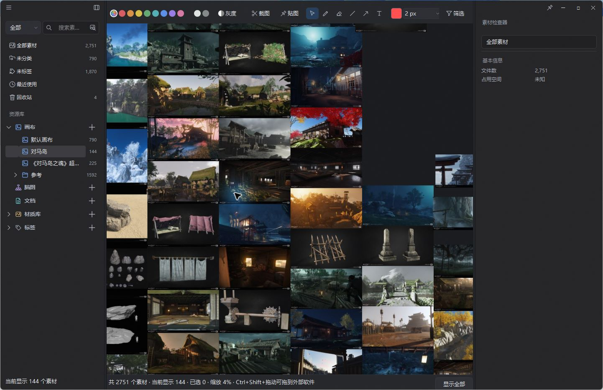
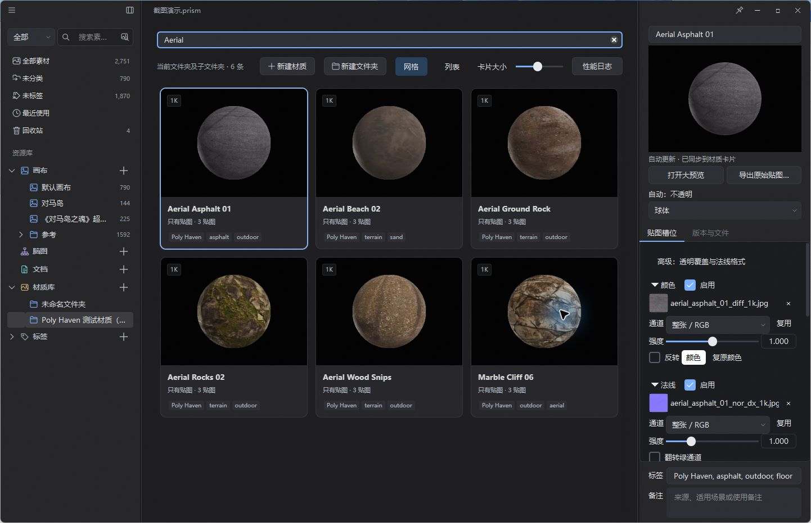
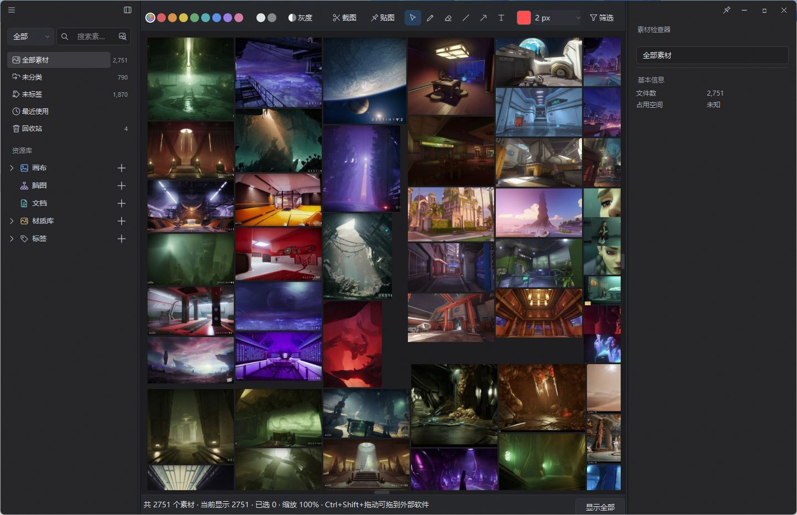

<p align="center"></p>
<h1 align="center">Prism</h1>
<p align="center">把参考图、PBR 材质、文档和脑图放进同一个本地创作工作区。</p>

<p align="center">
<a href="https://github.com/CLF7758/Prism/releases/download/v0.4.0/Prism-Setup-0.4.0-windows-x64.exe">下载 Windows 安装包</a> ·
<a href="https://github.com/CLF7758/Prism/releases/tag/v0.4.0">版本说明与源码</a> ·
<a href="README.en.md">English</a>
</p>

Prism 面向绘画、游戏美术与建模工作：在无限画布上整理参考图，用文件夹和标签管理素材，在材质库中收存原始贴图并查看 PBR 材质效果，同时记录文档与思维导图。项目保存在本地 `.prism` 文件里。

下面的截图来自用户真实的“测试.prism”项目副本，包含实际参考画布和 300 个测试材质，不是示意图。截图仅展示软件界面；项目原文件和整套素材不随安装包、源码发布。画面中的参考作品归各自作者所有。

## 无限画布：把参考图放在一起看

拖入图片后，自由移动、缩放、旋转、翻转和裁剪；按需要排列图片，用画笔、箭头和文字记录分析。多个画布分别保存不同主题，文件夹与全局搜索帮助你定位素材。



## 材质库：贴图入库，直接查看 PBR 效果

新建材质后，中间以材质卡片展示；单击卡片，在右边栏拖入电脑里的贴图、分配通道、填写标签和备注。支持文件夹、搜索、网格/列表、Ctrl 多选，以及右键或按钮导出原始贴图。

- 颜色、法线、粗糙度、金属度、AO、透明遮罩/透明度、自发光、SSS 和置换槽位。
- 每个槽位独立选择 RGB、R、G、B 或 A，可将同一张打包贴图复用于不同槽位，不强行按文件名猜通道。
- 自动分析透明信息，提供不透明、透明裁切与半透明显示；必要时可以人工覆盖。
- 平面、球体、圆柱体和立方体预览；双击进入大预览，并可单独查看贴图通道。
- Babylon.js 提供 PBR 渲染；SSS 使用薄表面透光近似，不能等同于任意 UE 母材质。
- 临时滑块、颜色等效果调节按当前设计在离开材质后复原；贴图绑定、通道、标签和备注属于材质资料。



材质库负责展示和收存。UE 插件、自动创建 UE 材质实例，以及 FBX/OBJ 自动转换的模型库目前没有作为本版本功能交付。

## 素材库与分类搜索

在同一个项目里按文件夹、标签和类型查找内容，搜索结果可以跳转到对应位置。也能通过本地以图搜图寻找相似参考，检查重复图片，再决定是否整理或移入回收站。



## 其他工作流

- **截图与桌面贴图**：区域截图送入画布，把参考图钉在桌面，调节透明度。
- **视频参考**：导入本地视频、播放与抽取画面；画布下载节点可收集支持平台的图片和视频。平台权限与接口变化可能影响下载。
- **文档与脑图**：富文本笔记、图片、分支规划都存入同一个项目；支持各自的导入导出以及 PDF 输出。
- **GLB/glTF 预览**：复用 Babylon.js 官方加载器查看模型，保留模型原有 PBR 材质。

## 原文件怎么保存、怎么导出

导入的原始文件与显示用缩略图、预览缓存分开保存。导出原始贴图时取回原文件字节，不拿压缩缩略图代替。PNG、JPG、TGA、EXR 等源格式不会因为生成预览被覆盖；具体格式的显示能力取决于已安装的解码组件。

原始导出与加工导出不同：裁剪图片、截图、视频抽帧和 PDF 是新生成的内容。如果旧项目已经丢失源文件，只有缩略图，软件无法恢复丢失的原图。

## 安装和使用

1. 下载 [Windows x64 安装包](https://github.com/CLF7758/Prism/releases/download/v0.4.0/Prism-Setup-0.4.0-windows-x64.exe)，按提示安装。
2. 新建或打开 `.prism` 项目，添加画布、文档、脑图或材质。
3. 用 `Ctrl+S` 保存。更新软件前建议备份自己的项目。

安装包提供截图、贴图、以图搜图和视频下载所需组件，安装到当前用户目录。主要验证环境为 Windows 11；安装包未签名，可通过 Release 同页 `SHA256.txt` 核对。PBR 预览需要可用的 WebGL/GPU 环境。

本轮修复了画布细节恢复、空间查询、缓存重复读取和若干保存一致性问题。大型项目冷加载、首次网页预览和部分缩略图生成仍可能出现延迟；这次发布不代表所有性能问题和测试缺口已消除。详见 [0.4.0 发布说明](docs/RELEASE_0.4.0.md)。

## 源码与开发

[下载对应版本源码](https://github.com/CLF7758/Prism/releases/download/v0.4.0/Prism-0.4.0-source.zip) · [Windows 打包说明](packaging/README.md) · [扩展与复用规范](docs/ARCHITECTURE_EXTENSION_GUIDE.md)

需要 Python 3.12：

```powershell
python -m venv .venv
.\.venv\Scripts\python -m pip install -r requirements/windows-lock.txt
.\.venv\Scripts\python -m pip install --no-deps -e .
.\.venv\Scripts\python -m prism
```

源码环境的截图、以图搜图和视频下载组件通过 `tools/setup_*_component.py` 准备；安装包已包含这些组件。浏览器图片收集扩展见 [browser-extension](browser-extension/README.md)。

项目采用 GPL-3.0-or-later，保留原始项目作者 Rebecca Breu 的版权声明。第三方引擎、组件及许可证见 [THIRD_PARTY.md](THIRD_PARTY.md) 和 [NOTICE](NOTICE)。
