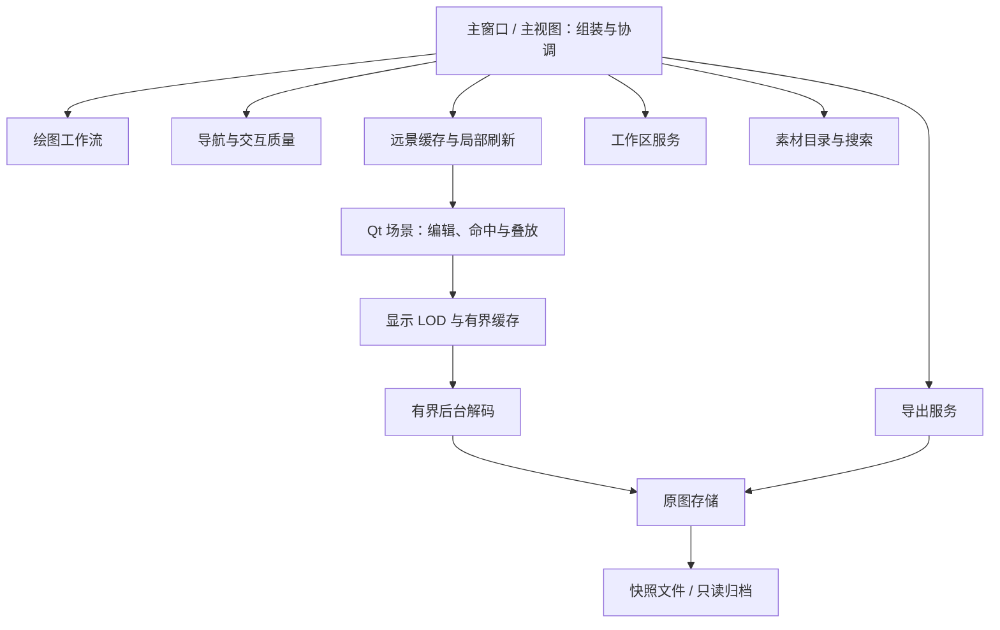

# Prism 架构与大画布 LOD 优化

## 2026-10-13 缩放与项目读写回归修正

- 普通保存不再执行 `VACUUM`；保留原始素材 BLOB，仍事务写入元数据。数据库空间压缩不属于每次保存的工作。
- 显示分级优先复用已有更高清缓存；64 像素旧预览不得登记成 192 像素缓存。可用预览升级到最多 192 像素并压缩持久化，继续兼容旧 64 像素预览。
- 编辑画布和大素材汇总画布均缓冲当前画面，等可见基础预览就绪后统一更新。几何变化、选择标识和正常编辑保持独立更新；停止缩放不再无条件清空画面。
- 大项目至少 128 个素材可见时进入缓冲绘制。后台队列满时停止继续扫描与请求，等待任务完成后补充可见任务。
- 项目读取期间延迟资源库刷新；完成后只排列一次。矩形分组从 128 缩小为 64，限制单组排列计算。
- 实测使用用户桌面原始 `测试.prism` 的只读加载及备份副本。完整打开/首帧、基础预览补齐和保存分别计时，不以读取元数据耗时替代完整打开时间。
- Eagle 参考来自 REA 对本机安装包的静态分析：可见图片队列、并发限制、缓存命中直接显示和独立缩略图路径。字节码核心未恢复，不声称复现全部内部实现。


日期：2026-10-13。已直接修改所提供的 `.github` 项目源码，按本地 Ponytail skill 的最小完整改动原则完成。本次不新增项目运行依赖。

## 已落地的行为

1. **远景总览缓存**：素材数量达到 2,000 且缩放足够远时，Qt 将视口及四周 25% 余量绘制到一张缓存图。密集小尺寸图片也通过视口密度进入此模式，避免只按原图分辨率判断。平移/缩放期间复用缓存，交互停止 120 毫秒后刷新。
2. **局部更新**：移动、选择、透明度等变化使用 Qt 的场景脏区域更新总览图，避免每次重新绘制几万个图元。Qt 场景绘制保留叠放、旋转、裁剪、透明度和灰度效果。
3. **显示级别**：普通图片按 32 / 64 / 192 / 512 / 1024 / 2048 / 4096 像素分级。屏幕上最长边不超过 8 像素时，使用至多 8 像素的微型预览，不请求原图解码。选中、裁剪和近景按照现有细节路径处理。
4. **显示内存预算**：192 像素预览与 LOD 级别共用 96 MiB 的 LRU 缓存，可恢复预览不再逐张永久驻留。每张微型预览最多 256 字节像素；每个视口的总览图最长边 2,048 像素，最多 16 MiB。原图、Qt 图元、项目元数据与其他模块的内存另计，96 MiB 不是整款软件的内存上限。
5. **后台解码调度**：两个工作线程，最多八个已提交请求；满队列保留仍可见的等待任务。暂未入队的视口在完成回调后合并重试，避免原来的连续取消、饥饿和逐张串行排队。离开视口、关闭窗口或替换来源的旧结果继续丢弃。
6. **几何与刷新分离**：位置、旋转、裁剪、文本和路径变化使内容范围失效；单纯图片刷新不再清空范围缓存。缩放引起的选择手柄变化不重扫内容；拖动和绘图期间延迟全范围计算。
7. **重开工程直接显示小图**：已有原始预览的图片保存至可选 `displayOverview` 元数据字段，包含最长边 8 像素的 RGBA 数据。恢复时先验证尺寸、编码长度和字节数，不读取原图。普通视图也能先显示这份微型预览，再补清晰级别。原图字节与数据库 schema 保持原有行为；调整过的显示像素不作为原始预览写入。

## 架构边界与扩展入口



| 模块 | 职责 / 本次处理 |
|---|---|
| `view.py` | 保留界面组装与操作协调，分离约 400 行导航和绘图逻辑；公开调用入口仍保留，包括工具条布局常量。 |
| `actions/drawing_workflow.py` | 绘图工具、笔画生命周期、橡皮擦、临时模式恢复。新增绘图能力在此改，避免继续堆进主视图。 |
| `canvas_navigation.py` | 平移、缩放、范围缓存、交互质量控制。 |
| `canvas_overview.py` | 总览缓存、脏区域更新、缓存录制作用域；可替换为分块缓存而不改导出格式。 |
| `lod.py` | 显示级别、显示内存、微型预览的生成与安全恢复。 |
| `image_decode.py` | 原生读取、后台 QImage 解码、请求生命周期与有界队列。 |
| `source_store.py` | 统一原图快照、只读归档访问和容量统计；删除图元/解码器中的重复 SQL，以及素材控件中的数据库操作。 |
| 工作区、素材目录、导出、导入、搜索服务 | 保留并复用已有职责划分。本次未引入新的总服务、插件框架或重复状态所有者。 |

修复了素材画布在首次布局前收到预览信号时缺少 `_item_rows` 的初始化问题。架构检查增加存储和解码模块的边界约束，并修复检查工具对 UTF-8 BOM 源文件的读取。

项目根目录新增 `AGENTS.md`，记录后续开发边界、数据安全约束与复测方法。新格式从导入服务和 `fileio` 扩展；新画布工具从绘图工作流和图元注册扩展；渲染优化集中在显示模块；工作区业务保持服务所有权。

## 性能测量

Windows、Python 3.12、Qt 6.7.0、`QT_QPA_PLATFORM=offscreen`。合成元数据和纯色预览，不包含真实图片解码、磁盘导入、完整主窗口业务开销或 GPU。下面是渲染路径测量，不能转换为真实工程 FPS 保证。

| 场景 | 首次总览构建 | 缓存重绘中位数 | 平移中位数 | 局部更新中位数 |
|---|---:|---:|---:|---:|
| 10,000 图、模拟长边 1,600 | 124.21 ms | 0.253 ms | 0.258 ms | 0.560 ms |
| 30,000 图、模拟长边 1,600 | 386.36 ms | 0.334 ms | 0.318 ms | 0.815 ms |
| 30,000 小图、长边 64 | 383.30 ms | 0.234 ms | 0.204 ms | 1.228 ms |

修改前的同一万图脚本，逐图重绘中位数为 **100.23 ms**，一万张普通预览全部驻留。当前一万/三万图场景只保留 1,213 张普通预览；显示缓存约 96 MiB，总览图约 5.4 MiB，远景绘制解码请求为零。修改前与当前的稳定重绘是不同缓存策略，首次构建费用单独列出，不能把差值当作整体启动加速。

复测：

```text
python tools/canvas_stress.py --items 10000 --output canvas-10000.json
python tools/canvas_stress.py --items 30000 --output canvas-30000.json
python tools/canvas_stress.py --items 30000 --image-side 64 --scale 0.08 --output canvas-small-30000.json
```

## 验证范围

- 架构与主要行为大范围回归：**796 项通过**。覆盖图元、选择、场景、视图、绘图、LOD、解码、导出、资源库、拖放与数据安全。
- 最终持久化/渲染验证：**157 项通过**，覆盖 SQL 读写、原图导出、懒加载、透明度、微型预览往返、损坏字段、调整像素隔离、叠放、缓存失效、局部移动与几何延迟。
- 大范围运行排除了 11 项在修改前源码中也复现的既有失败：旧裁剪边界期望、旧 pixmap mock 绘制期望、两项选择框样式期望、三项导入完成回调 mock、旧浮动工具条可见性、`lastUsed` 元数据期望、旧画布灰度上下文、离屏树行布局。pytest 的前缀排除额外排除了一个裁剪绘制测试，最终验证单独重新执行该项并通过。未声称整个项目测试套件全绿。

## 已知限制与下一步边界

- 这是针对当前架构的实际整理与核心性能改造，主窗口和图元文件仍较大，尚未把整个项目所有模块逐一重写。
- 原生 Qt 图元仍逐素材存在。缓存解决远景绘制热路径，不能消除全部对象创建、项目读取、索引和真实图片解码成本。十万级以上对象若受构建/命中成本限制，应由素材记录驱动只实例化可见编辑图元，继续复用目录和存储服务。
- 首次总览构建仍有一次费用，三万图合成场景约 0.39 秒；大跳转超出缓存时可能短暂露出背景，交互停止后补齐。若该费用在真实项目成为主要瓶颈，再将当前视口缓存改为分块缓存与邻区预取。
- 旧工程没有 `displayOverview` 时使用占位/已有缓存；已有原始预览的素材在保存后能持久化微型预览。没有为了补齐旧工程而同步读取所有原图。
- 本次不修改原图和个人工程文件，也没有重新构建/替换已安装的 EXE。需要从更新源码运行或按既有打包流程重新打包，才能用于安装版。
- 没有验证真实三万张不同格式图片、大型真实工程、4K 多显示器或 GPU 场景；完整软件体验需要在目标机器和实际工程上验收。

## 修改包与回退

`Prism-architecture-lod-changes.zip` 中 `updated/` 是修改后的相对项目路径，`before/` 保存此次修改前的相应文件，`manifest.json` 标记新增文件。源码已直接落地，不需要再次应用包。

回退时恢复 `before/` 中的对应文件，并移除 manifest 标记的新增文件。包不包含运行时、个人素材、工程数据库或发布凭据。`Prism-architecture-lod.patch` 供代码审阅，原始性能 JSON 和最终测试 XML 一并保存。
