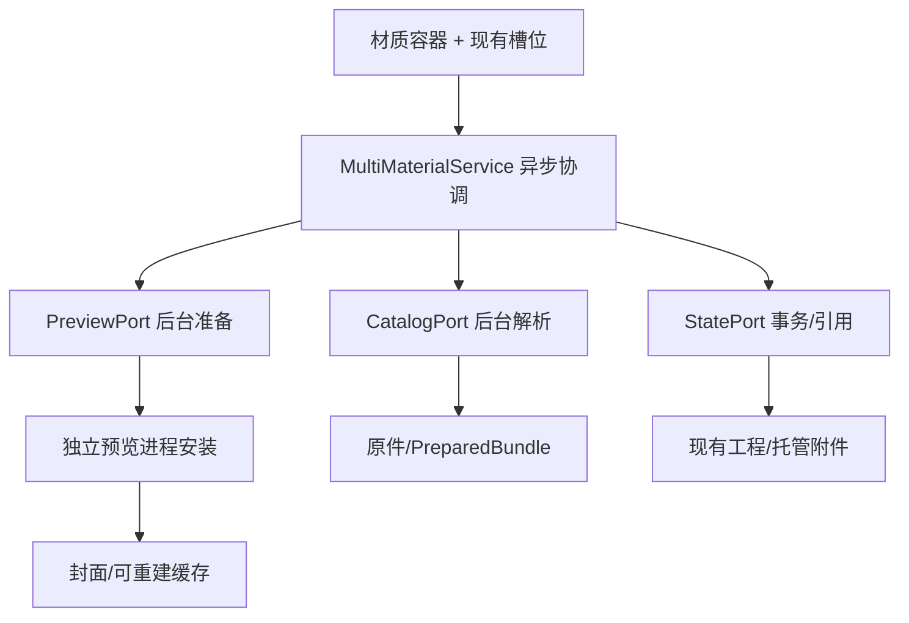

# Prism 模型多材质编辑：V2 框架与交接方案

日期：2026-10-27。只处理模型多材质编辑。本轮已搭代码骨架，具体解析、编辑、保存、原生局部渲染均未实现；本文取代旧稿。各 AI 不得把框架、禁用按钮或测试替身称为功能完成。

## 1. 项目背景与目标

Prism 是 Python/PyQt6 桌面资产与知识管理工具，已有材质库、模型库、画布、脑图、文档、目录、标签、备注和托管附件。目标用户做动漫、游戏生产。

本任务完整操作链：导入 FBX/OBJ/GLB/glTF → 自动显示原有材质 → 定位材质或部位 → 从已有材质库换材质/手动换贴图 → 只影响指定范围 → 预览/撤销/保存/重开 → 原件完整导出。

源码目录 `C:/Users/admin/Desktop/Prism-main/Prism-main`；Python `.venv/Scripts/python.exe`。不是 Prism测试 中的另一份源码。当前无 Git，不编提交号。不得重写已有材质库、标签、目录和模型列表，也不新增 DCC 建模、节点编辑器或转换导出。

## 2. 设计依据与旧方案缺口

旧稿没有充分定义共享范围、独立副本、清除与继承、替换语义、资源回收、事务和后端否决实验。V2 以“范围明确、数据不丢、可恢复、同一状态驱动显示”为核心。

成熟工具可核对的机制：Blender 分离材质数据与槽位分配，区分共享与独立；Unreal 材质实例使用继承和覆盖，FBX/Datasmith 保留导入匹配信息与用户覆盖。Prism 借鉴机制，不照搬 DCC/引擎界面。以下是官方依据，不代表作者背书本方案，查询于 2026-10-27：

- [Blender 材质分配](https://docs.blender.org/manual/en/latest/render/materials/assignment.html)
- [Blender 独立追加与链接](https://docs.blender.org/manual/en/5.0/editors/asset_browser.html)
- [Unreal 材质实例](https://dev.epicgames.com/documentation/en-us/unreal-engine/instanced-materials-in-unreal-engine)
- [Unreal FBX 材质管线](https://dev.epicgames.com/documentation/unreal-engine/fbx-material-pipeline-in-unreal-engine)
- [Datasmith 重导入](https://dev.epicgames.com/documentation/en-us/unreal-engine/datasmith-reimport-workflow-in-unreal-engine)

## 3. 当前事实和本轮实际修改

| 源码事实 | 证据 | 实现影响 |
| --- | --- | --- |
| 现有 appearance 是单份平面配置 | contracts.py:ModelAppearance、appearance.py | 不能直接当多材质数据。 |
| 原生覆盖是全模型参数 | f3d_parameters.py:ParameterSnapshot.option_values | 不能包装成局部编辑假 API。 |
| 材质库选择是简单名称下拉 | composition.py:apply_material | 新流程需要复用可视化卡片。 |
| 附件引用只收集 files 和顶层 bindings | project_storage.py:register_model_attachments/model_attachment_ids | 嵌套材质新增贴图可能漏进保存/清理链，必须补齐。 |
| 外观更新会触发封面及活动预览重开 | service.py:update_appearance | 草稿要与提交拆开，避免每次拖动重建场景。 |
| F3D Assimp 内部有材质分配关系 | 下载源码 vtkF3DAssimpImporter.cxx 的 Properties/mMaterialIndex/SetProperty | 不等于已安装 Python API 暴露稳定编辑端口。 |
| 当前材质球 SSS 路径用 translucency | assets/materials/render.js:isTranslucencyEnabled | UI 名称不能证明真正散射。 |

已搭代码，均相对 prism/：

- model_library/multimaterial/contracts.py：目标身份、源清单、工作材质、使用点、贴图三态修改、命令、能力、回执；不是磁盘 schema。
- model_library/multimaterial/ports.py：解析、状态、后台准备、原生安装、异步门面 Protocol；没有实现。
- model_library/multimaterial/service.py：默认能力全关，执行方法抛未实现错误，不假成功。
- widgets/model_material_panel.py：无假数据的材质列表容器和禁用动作。
- model_library/service.py：暴露 service.multimaterial 接入点。
- widgets/model_details.py：“材质”页挂接容器，旧全模型控件保留并标明兼容范围。

尚未实现真实材质识别、局部编辑、实例拆分、新持久化、局部原生显示与撤销。已有通道预览及离屏结果不能作为多材质编辑证据。

## 4. 最终交互，必须按这个目标开发

### 导入与显示

原件导入复用现有路径；后台新增材质清单。分别报告未解析、解析中、失败、缺图、部分显示、可编辑。未知数量不显示 0，解析失败不等于无材质。中间仍显示模型封面；右侧显示内部材质小预览、名称、使用部位数、修改/缺图状态。不要自动把内部材质灌进全局材质库。

### 定位与共享

点材质行临时高亮全部使用部位；高亮不改材质、不进封面。大预览用明确的“选择材质”工具拾取，与列表同步；不抢普通旋转。透明重叠需候选命中，能力未验收前保持禁用。

四条椅腿共用木材，显示“木材，影响 4 处”。编辑这份材质默认四条一起变。只改左前腿：先指定使用点，再“仅此部件独立”，复制工作材质并重绑一处；不复制几何和原贴图字节。mesh 多实例时，使用点必须包含实例路径。选择材质不等于已经选择具体部位。

### 编辑与替换

当前材质下复用 MaterialSlot，始终写明目标和影响范围。原值、快照、本地覆盖可追溯；纯数值材质合法。三态严格区分：继承/重置、设置、明确清除。清除不能让旧图重新继承；缺省不能等同于 0 或禁用。材质改名不改变身份。

从已有库替换时，在模型上下文中复用卡片、搜索、标签；不离开模型再找目标，不再用只有名字的长列表。拖放必须命中明确材质；无目标不全模型应用。

默认“替换表面”：替换颜色、法线、粗糙度、金属度、AO、自发光与数值；保留透明/镂空、双面、SSS、置换、几何分配。高级“替换完整材质”完整采用新定义及明确默认值，应用前展示关键变化；不新增全局开关。

旧 basecolor 的 A 可能是镂空来源，替换 RGB 时要保留旧 A 的独立资源引用。材质库选择先预览，应用提交一次，取消丢草稿。默认配置与依赖快照，源库修改/删除不改变已用模型，保留来源 ID/版本供追溯。

### UV、法线与工作流

未编辑时保留原 UV 集、逐图变换、采样、颜色空间和法线方向。单图替换继承原槽坐标；整组库材质替换采用目标有效表面 UV 和新材质自身变换，不默默叠加旧缩放。保留的透明通道保留独立坐标。缺 UV 时具体报错，不暗中展开 UV、减面或改原件。

法线约定按贴图保存，不能全模型翻绿；bump 不冒充 normal。Phong/Lambert 不谎称完整 PBR。生成派生切线或转换工作流要记录算法与保真结果。

### 保存、撤销、导出

滑条草稿即时预览，一次手势一次事务/撤销；文本按一次字段编辑合并。切换目标前处理手势，旧回调不得写新目标。替换、独立、恢复材质、恢复全模型分别为完整命令；恢复全模型同时恢复原始分配，不改标签/备注/目录。

区分预览中、保存中、已保存但封面更新、保存失败和预览失败；持久化回执确认保存，图像回执确认显示。渲染失败不抹掉正确提交，截图成功不能代替保存成功。Ctrl+Z 优先文本编辑器，否则用项目历史。计时器合并不等于事务撤销。

沿用只导出原件的约定：单个/批量逐文件哈希一致，不转换。修改只存 Prism 工程；有修改时提示“原件导出不包含 Prism 外观修改”。新图随工程搬迁。当前约定无法把修改外观直接交给其他软件，必须披露这个生产断点，不擅自做转换导出。

## 5. 数据架构与所有权



MaterialDefinition 是固定源版本的定义；BindingSite 是节点实例/几何/primitive 或面组使用点；WorkingMaterial 是可共享的本地 UUID；MaterialAssignment 是使用点到工作材质；TextureUse 是资源加通道/UV/颜色空间。名字、actor 序号、贴图哈希都不当材质身份。

WorkingMaterial.base_snapshot_ref 非空时，它是独立库材质快照的继承基础；为空时使用 source_material_id 对应源定义。provenance_json 仅记录来历，不能当作可随时读取源库的活链接，也不能代替受管基础快照。恢复原材质是恢复原基础与原分配的显式操作。

数量统计实际使用的不同工作材质，共享 100 处仍为 1；未使用定义和未指定组单列。跨源版本不能按索引强配，需保留匹配证据和歧义。旧全模型覆盖显式兼容保存，不自动散布到每个源材质。

存储继续现有 SQLite/托管附件。完整源清单一旦参与编辑，保存版本化语义快照；清缓存不能重置身份。优先原型是受管清单文档 + 模型记录引用 + 稀疏工作覆盖/分配差异，不把完整几何和清单塞进每次修改的 JSON。

磁盘 schema 仍需实验：比较稀疏 JSON/按材质拆表在 1/10/100/1000 材质时的单槽 SQL、WAL、序列化和恢复成本，主对话定案。新表必须接完整/局部保存、另存和目录工程转换，不用不兼容 GENERATED 列。嵌套未知字段与扩展需重开保留；不凭 unknown_fields 承诺旧程序能安全写新格式，需验证版本拒写或记录不兼容。

新增图暂存、哈希核对，固定修订后原子提交状态和资源引用，再发持久化回执及登记历史。实际事务能力必须验证，不虚构跨进程原子性。引用收集覆盖清单、工作材质、继承图、新图、撤销/重做、预览租约、回收站。取消释放自己的暂存；历史保留资源；删除源材质库不影响模型快照。

保存中编辑进下一修订，旧回执不清新脏标记。恢复区分已提交但 UI 未更新与未提交草稿。正式封面只接受最新已提交完整状态；高亮、孤立、通道和草稿不能覆盖它。

MaterialTarget 已包含 project_session/open_epoch/model_id/source_revision/catalog_revision/state_revision；请求有 request_id/gesture_id，预览有 draft_generation。安装前核对全部身份和代次。后台 inspect/load/prepare 不碰 QWidget；原生 install 在独立进程所属线程。门面返回 job_id 不等于完成。

UI 不读原件/数据库，存储不渲染，渲染不保存工程。复用旧参数体系，不让各角色发明平行 API。contracts/ports 目前只冻结依赖方向，调度/错误序列化/schema 校验待实现并提交 RFC。

## 6. 渲染路线和停止条件

优先验证 F3D 显式局部材质端口，保留 FBX/OBJ 原生读取。固定安装版、下载源码摘要及差异；master 不等于已装 4.0.0。实验必须证明源使用点映射、共享与实例独立、取消与恢复。

禁止私有指针、猜 actor 序号、全局覆盖假装局部。公共 API 不足可提最小 C++/绑定扩展，但须交 Windows 可安装运行时、版本固定、构建和回退；目的为补控制边界，不泛称加速。

备选是预览工作副本：glTF/GLB 派生材质且保留几何，OBJ 工作 MTL，FBX 转换需证明 UV/分组/层级/单位等保真。只读 preview_channels 不算完整编辑端口。Babylon 可复用小预览，但若承担模型编辑，需独立证明模型加载和材质解释一致。

路线实验失败就交阻断，不开假按钮。主对话选定路线后再扩建，不能多个 AI 各换一套渲染器。

## 7. 必需功能的完成定义

| 功能 | 交付条件 |
| --- | --- |
| 四格式识别 | 定义/分配/贴图/数值/UV 可追溯，缺失可定位。 |
| 局部与共享 | 目标正确、不误改；独立仅重绑选定使用点。 |
| 库替换 | 卡片选择/预览/应用/取消、快照依赖、表面/完整替换一致。 |
| 贴图与法线 | 三态、通道、坐标、色彩空间、方向可核对。 |
| 选择与显示 | 高亮/拾取/通道不污染正式外观；失败保留最后正确帧。 |
| SSS | 明确算法与支持语义，真实散射样本核验；透明/透射/薄透光不充数。 |
| 置换 | 明确几何策略/边界/预算，不冒充 bump，不改原件。 |
| 纯线框 | 不填充面，说明原拓扑/三角化边，不冒充 show_edges。 |
| 保存/历史 | 重开/另存/搬迁/故障恢复/撤销资源保留通过。 |
| 导出原件 | 修改前后与导入清单逐文件哈希一致，说明不带修改外观。 |

可以分阶段交付，不删除用户要求，不将禁用入口当最终完成。

## 8. 并行与接手顺序

四份任务书在 docs/model-multimaterial-tasks/，每 AI 只发对应一份。主对话集成，没有第五个总集成 AI。

G0：各自核对框架和基线。G1 可并行：AI 1 清单/引用实验，AI 2 后端否决实验，AI 3 测试替身 UI，AI 4 独立期望。G2：映射和事务实验通过后贯通单目标编辑。G3：共享独立/库替换/历史与恢复。G4：高级效果逐项。G5：独立验收后主对话开启生产能力。

共享 contracts/ports 由主对话管理，角色提交 RFC。旧 service/composition、全局保存和真实工程迁移由主对话装配；角色交最小候选补丁。所有权冲突先报告，不覆盖并行修改。

## 9. 独立验收、性能与质量

夹具覆盖共享、多实例、同名、单 mesh 多 primitive、无/未使用材质、缺图、多 UV、RGB/A 共图、ORM、内嵌图、外 BIN、绝对路径、透明重叠、损坏和源版本重排。期望来自原 JSON/MTL/FBX 或独立 DCC，不由被测解析器生成。原 20 样本不能替代这些结构夹具。

旅程逐格式记录：导入原材质 → 局部改 → 独立共享部位 → 换表面保留镂空 → 预览取消 → 应用 → 撤销重做 → 保存重开 → 搬迁 → 导出原件哈希。写失败/磁盘满、丢回执、保存中编辑、预览崩溃、取消、过期回调、切项目、删源材质、清缓存都要故障核验。

候选性能阈值须先绑定 CPU/RAM/GPU/驱动/磁盘、模型/贴图和冷暖缓存，未绑定不得签通过：库 100/1000/1万/10万，单模型 1/10/100/1000 材质；仅需求解析；可见/预取预览候选 32/64 张；暖选材质到属性 P95≤100ms，准备完成到画面 P95≤100ms，主 GUI 最长停顿候选≤50ms。冷准备另计且完整披露，记录 P50/P95/P99、最长停顿、峰值、50 次往返趋势、单槽读写/WAL/工程增长。

禁止降画质、停 GC、隐藏数据或不计准备时间“达标”。GUI 不跑重活、主进程不 import F3D；原生先 F3D 后 Qt；无全局当前材质、静默成功、原件覆写。未知字段 round-trip、可取消/关闭与结构化错误必须验证。

日志复用 model_library.events，记录解析/草稿/提交/安装/过期/缺失/回滚，带身份、修订、阶段、耗时、错误码；不每帧刷日志、不存原始字节。小 API、截图、缓存率不替代用户旅程。

## 10. 交付与回退

每 AI 更新自己的任务书，交文件摘要、运行版本、实际命令和原始日志、证明范围、失败/跳过/未测、RFC、回退、剩余依赖。无 Git 用相关文件 SHA-256。不得编造测试结果或将旧基线算新增验收。

主对话逐项装配能力。回退关闭新服务，保留旧路径；不能删新状态来回退工程。迁移先验证，不擅自用真实工程做不可逆操作。

- [AI 1 数据与事务](model-multimaterial-tasks/AI_1_MATERIAL_DATA.md)
- [AI 2 原生渲染](model-multimaterial-tasks/AI_2_MATERIAL_RUNTIME.md)
- [AI 3 编辑 UI](model-multimaterial-tasks/AI_3_MATERIAL_UI.md)
- [AI 4 独立验收](model-multimaterial-tasks/AI_4_MATERIAL_ACCEPTANCE.md)

## 11. 本轮框架交付检查（不是功能验收）

新增及相关旧功能离屏回归：149 passed、1 skipped，31.95 秒。新增框架检查证明默认服务不会报成功、容器不造假数据、不启用动作、切模型清除旧上下文；不证明局部材质编辑已实现。未开启可见原生 GUI，未控制桌面，未写入用户测试工程。

代码通过 compileall，四份任务链接存在。原始回归在 `artifacts/model-multimaterial-framework-20261027/regression.txt`，框架单独检查在 `scaffold.txt`，相关文件 SHA-256 在 `framework-baseline.json`。哈希文件记录的是生成时快照；后续角色修改后应重新记录，不得假定始终一致。

接手先执行：

```powershell
$env:QT_QPA_PLATFORM='offscreen'
.venv/Scripts/python.exe -m pytest -q tests/model_library/test_multimaterial_scaffold.py tests/test_model_library_scaffold.py tests/model_library/test_ui.py tests/model_library/test_appearance.py
```

默认不可用服务的旧断言在实现后可以按新契约修订，但必须新增真实行为验收，不得只删除安全门测试来让按钮可点。各角色新增实现测试放任务书指定目录，与框架基线分开。
